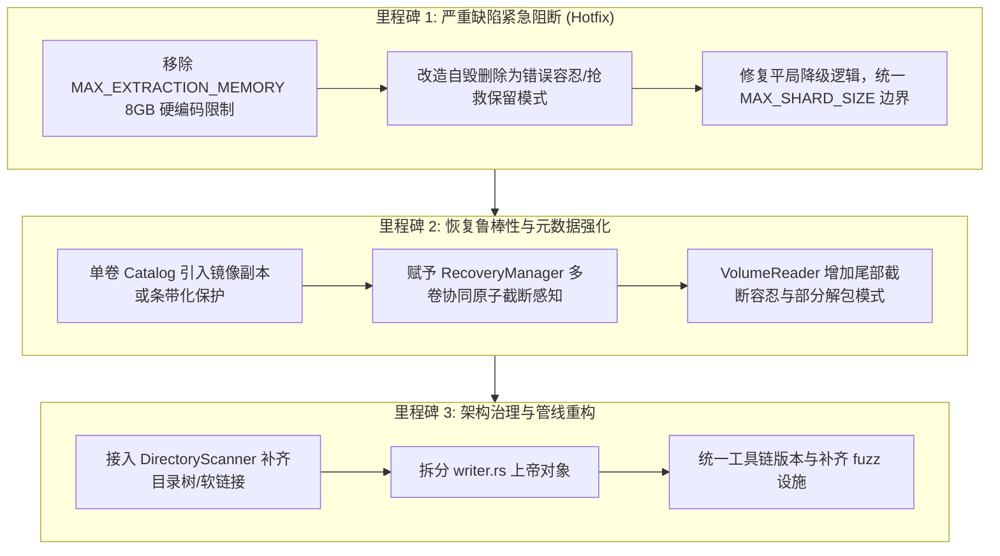

# ERA-CORE 恢复缺陷与系统风险综合审计报告 (Consolidated Risk & Recovery Audit)

**生成日期:** 2026-10-10  
**审查分支:** `feat_fly` (Commit: `e4050a2`)  
**审计基线:** 整合并交叉核验 [`docs/risk-assessment-2026-10-09.md`](file:///home/ricardom/code/github.com/zapsaang/era-core/docs/risk-assessment-2026-10-09.md) 与 [`docs/recovery-failure-scenarios-and-flaws-2026-10-10.md`](file:///home/ricardom/code/github.com/zapsaang/era-core/docs/recovery-failure-scenarios-and-flaws-2026-10-10.md)  
**评估维度:** 规范符合性 (Spec Compliance)、代码质量 (Code Quality)、安全性 (Security)、性能 (Performance)、并发与一致性 (Concurrency & Consistency)、运维与恢复可靠性 (Operational Risk)  
**分析方法:** 静态源码行级核查、调用链追踪、历史审计报告交叉验证、事实仲裁与去重合并  

---

## 一、 执行摘要与仲裁结论

针对 2026-10-09 与 2026-10-10 提交的两份问题报告，本审计对所有 18 项原始问题点进行了逐一源码定位、事实核查与去重仲裁。

### 1.1 总体仲裁结论

1. **基本主链路功能可用**: 在常规单卷/多卷正常环境及标准 RS 4+2 损坏场景下，压缩打包（`create`）、解包恢复（`extract`）与分片修复（`repair`）主流程已通过 2737 项自动化测试验证，基础功能完备。
2. **极端恢复盲区与“自毁式”清理证实存在 (Critical)**:
   - 提取引擎中硬编码的 8GB 预算本意用于防御解压炸弹，但错误绑定至全生命周期累计解包字节数，导致解压大归档（>8GB）必遭误杀；
   - 触发错误后调用的 `fail_extraction_with_cleanup` 会物理删除磁盘上已还原的所有文件；当遇到连续 16 个坏块时同样触发该自毁清理，彻底摧毁“尽力而为（Best-effort salvage）”的容灾能力。
3. **元数据韧性与矩阵一致性缺陷证实存在 (High)**:
   - 单卷归档中的 Catalog（目录索引）作为独立 Canonical 块写入，完全排除在 Reed-Solomon 纠删码条带化和 `repair` 扫描范围之外，且卷内无备用指针备份，一旦 bit-rot 损坏即造成整包灭门；
   - 崩溃恢复管理器 `RecoveryManager` 缺乏多卷意识，中途崩溃后若执行 `repair --force` 会单方面截断 Volume 0，造成跨卷轮转条带矩阵状态撕裂（Matrix State Tearing）。
4. **安全防御边界冲突证实存在 (High/Medium)**:
   - 前缀一致性协调在出现平局时返回 `None`，降级路径绕过了 Parity Bound 校验，攻击者可通过恶意构造平局条带诱发 1.5GB+ 内存超配并触发 OOM 拒绝服务；
   - `era-volume` 声明 16MB 反 DoS 限制，但底层 `read_raw` 缺乏校验，而上层 `era-engine` 使用 256MB 限制，存在 16 倍的防御边界割裂。
5. **CLI 接线缺口导致目录树与过滤能力退化 (Medium)**:
   - `era-cli` 绕过了 `era-ingest` 已实现的 `DirectoryScanner`，退化为裸 `walkdir`，导致空目录、软链接和特殊文件被静默丢弃。

---

## 二、 事实核查与问题合并追溯矩阵

本矩阵对照 2026-10-09 与 2026-10-10 两份报告的所有原始问题条目，标明事实核查状态、合并关系与仲裁分级。

| 整合编号 | 原始报告来源 | 问题主题 | 仲裁状态 | 严重度 | 审计核心维度 | 关键源码锚点 |
| :--- | :--- | :--- | :---: | :---: | :--- | :--- |
| **SEC-CRIT-01** | 10-10 §2.1 + 10-10 §3.4 | 8GB 累计解包误杀与自毁式删盘 | **已证实** | **Critical** | 正确性 / 安全 / 容灾 | [`reader.rs:47`](file:///home/ricardom/code/github.com/zapsaang/era-core/crates/era-engine/src/reader.rs#L47), [`reader.rs:1683-1708`](file:///home/ricardom/code/github.com/zapsaang/era-core/crates/era-engine/src/reader.rs#L1683-L1708), [`reader.rs:1877`](file:///home/ricardom/code/github.com/zapsaang/era-core/crates/era-engine/src/reader.rs#L1877) |
| **DATA-CRIT-02** | 10-10 §2.2 + 10-09 §1.4 | 单卷 Catalog 缺乏纠删码保护 (SPOF) | **已证实** | **Critical** | 正确性 / 规范符合性 | [`writer.rs:3533`](file:///home/ricardom/code/github.com/zapsaang/era-core/crates/era-engine/src/writer.rs#L3533), [`erasure_scan.rs:91`](file:///home/ricardom/code/github.com/zapsaang/era-core/crates/era-engine/src/erasure_scan.rs#L91), [`repair.rs:401`](file:///home/ricardom/code/github.com/zapsaang/era-core/crates/era-engine/src/repair.rs#L401) |
| **DATA-HIGH-01** | 10-10 §2.3 + 10-10 §3.4 | 连续 16 坏块自毁退出清盘 | **已证实** | **High** | 正确性 / 容灾降级 | [`reader.rs:1655`](file:///home/ricardom/code/github.com/zapsaang/era-core/crates/era-engine/src/reader.rs#L1655), [`reader.rs:1716-1726`](file:///home/ricardom/code/github.com/zapsaang/era-core/crates/era-engine/src/reader.rs#L1716-L1726) |
| **CONS-HIGH-02** | 10-10 §2.4 + 10-09 §1.1 | `repair --force` 截断致多卷矩阵撕裂 | **已证实** | **High** | 并发与一致性 | [`recovery.rs:364-428`](file:///home/ricardom/code/github.com/zapsaang/era-core/crates/era-engine/src/recovery.rs#L364-L428), [`commands.rs:1236-1260`](file:///home/ricardom/code/github.com/zapsaang/era-core/bins/era-cli/src/commands.rs#L1236-L1260) |
| **SEC-HIGH-03** | 10-10 §3.3 + 10-10 §3.2 | 前缀平局降级致 1.5GB 内存峰值与 DoS | **已证实** | **High** | 安全 / 性能 | [`erasure_scan.rs:24-42`](file:///home/ricardom/code/github.com/zapsaang/era-core/crates/era-engine/src/erasure_scan.rs#L24-L42), [`block_iter.rs:1475-1508`](file:///home/ricardom/code/github.com/zapsaang/era-core/crates/era-engine/src/block_iter.rs#L1475-L1508) |
| **DATA-HIGH-04** | 10-10 §2.5 | 卷尾截断拒绝进入解包恢复 | **已证实** | **High** | 正确性 / 容灾降级 | [`era-volume/reader.rs:91-98`](file:///home/ricardom/code/github.com/zapsaang/era-core/crates/era-volume/src/reader.rs#L91-L98) |
| **CODE-HIGH-05** | 10-09 §3 (79) + 10-10 §3.1 | `writer.rs` 3650 行上帝对象过度耦合 | **已证实** | **High** | 代码质量 / 可维护性 | [`writer.rs:1-3650`](file:///home/ricardom/code/github.com/zapsaang/era-core/crates/era-engine/src/writer.rs) |
| **SPEC-MED-01** | 10-10 §2.6 + 10-09 §3 (83) | 空目录/软链接丢失与 DirectoryScanner 闲置 | **已证实 (合并)** | **Medium** | 规范符合性 / 代码质量 | [`commands.rs:672-690`](file:///home/ricardom/code/github.com/zapsaang/era-core/bins/era-cli/src/commands.rs#L672-L690), [`reader.rs:1772`](file:///home/ricardom/code/github.com/zapsaang/era-core/crates/era-engine/src/reader.rs#L1772), [`era-ingest/reader.rs:47`](file:///home/ricardom/code/github.com/zapsaang/era-core/crates/era-ingest/src/reader.rs#L47) |
| **SPEC-MED-02** | 10-09 §1.1 + 10-09 §4.3 | `repair` 拒绝修复丢失卷文件，语义脱节 | **已证实** | **Medium** | 规范符合性 / 交互设计 | [`commands.rs:1139-1147`](file:///home/ricardom/code/github.com/zapsaang/era-core/bins/era-cli/src/commands.rs#L1139-L1147) |
| **SEC-MED-03** | 10-10 §3.2 | 存储层 (16MB) 与引擎层 (256MB) 安全边界冲突 | **已证实** | **Medium** | 安全 / 架构一致性 | [`era-volume/lib.rs:16`](file:///home/ricardom/code/github.com/zapsaang/era-core/crates/era-volume/src/lib.rs#L16), [`block_iter.rs:68`](file:///home/ricardom/code/github.com/zapsaang/era-core/crates/era-engine/src/block_iter.rs#L68), [`era-volume/reader.rs:240`](file:///home/ricardom/code/github.com/zapsaang/era-core/crates/era-volume/src/reader.rs#L240) |
| **SEC-MED-04** | 10-09 §2.1 + 10-09 §2.2 | CLI 明文密码传参与帮助示例误导 | **已证实** | **Medium** | 安全 / 运维安全 | [`bins/era-cli/src/main.rs:65, 172`](file:///home/ricardom/code/github.com/zapsaang/era-core/bins/era-cli/src/main.rs#L65) |
| **TEST-MED-05** | 10-09 §3 (82) | Fuzz 测试套件缺失与幽灵工作流 | **已证实** | **Medium** | 代码质量 / 基础设施 | [`Cargo.toml:3`](file:///home/ricardom/code/github.com/zapsaang/era-core/Cargo.toml#L3), `.github/workflows/fuzz.yml` |
| **SEC-LOW-01** | 10-09 §2.3 | 进程内存残留面与 Coredump 策略未显式禁用 | **需关注** | **Low** | 安全 / 系统防御 | [`crates/era-crypto/src/secure_memory.rs`](file:///home/ricardom/code/github.com/zapsaang/era-core/crates/era-crypto/src/secure_memory.rs) |
| **SPEC-LOW-02** | 10-09 §2.4 + 10-10 §2.7 | 门限模式限制：禁止 Append 与重复凭证拦截 | **已证实 (符合规范)** | **Low / Info** | 规范符合性 / 密码学约束 | [`writer.rs:474-481`](file:///home/ricardom/code/github.com/zapsaang/era-core/crates/era-engine/src/writer.rs#L474-L481), [`commands.rs:254-272`](file:///home/ricardom/code/github.com/zapsaang/era-core/bins/era-cli/src/commands.rs#L254-L272) |
| **CONF-LOW-03** | 10-09 §3 (80, 81) | 工具链漂移 (1.98.1 vs stable) 与缺少 workspace.lints | **已证实** | **Low** | 工程治理 / 规范一致性 | [`rust-toolchain.toml:2`](file:///home/ricardom/code/github.com/zapsaang/era-core/rust-toolchain.toml#L2), [`.github/workflows/ci.yml:36`](file:///home/ricardom/code/github.com/zapsaang/era-core/.github/workflows/ci.yml#L36) |
| **OPS-INFO-01** | 10-09 §1.2, §1.3, §4.1, §4.2, §84 | RS 理论极限、SuperHeader 单点、路径扁平化、小包膨胀、空 cache 目录 | **已证实 (固有属性)** | **Informational** | 运维与系统特性 | 见下文详细阐述 |

---

## 三、 深度核查与问题分析（按严重度分级）

### 3.1 严重级别问题 (Critical)

#### SEC-CRIT-01: 累计解包量超过 8GB 触发伪"解压炸弹"拦截并自毁已解压文件

* **严重度**: Critical
* **审计维度**: 正确性 / 安全 / 容灾可靠性
* **代码锚点**:
  * [`crates/era-engine/src/reader.rs:46-47`](file:///home/ricardom/code/github.com/zapsaang/era-core/crates/era-engine/src/reader.rs#L46-L47)
  * [`crates/era-engine/src/reader.rs:1683-1708`](file:///home/ricardom/code/github.com/zapsaang/era-core/crates/era-engine/src/reader.rs#L1683-L1708)
  * [`crates/era-engine/src/reader.rs:1877-1888`](file:///home/ricardom/code/github.com/zapsaang/era-core/crates/era-engine/src/reader.rs#L1877-L1888)
* **事实与代码证据**:
  1. `reader.rs` 定义了硬编码常量：
     ```rust
     const MAX_EXTRACTION_MEMORY: u64 = 8 * 1024 * 1024 * 1024; // 8GB
     ```
  2. 在 `extract_with_iterator` 流式迭代解码时，变量 `cumulative_bytes_extracted` 不断累加每个块解出所有 chunk 的明文大小：
     ```rust
     cumulative_bytes_extracted = cumulative_bytes_extracted.checked_add(block_bytes)...;
     if cumulative_bytes_extracted > MAX_EXTRACTION_MEMORY {
         return Self::fail_extraction_with_cleanup(
             EraError::Security("Extraction memory budget exceeded: possible decompression bomb".to_string()),
             &tracked_output_files,
         ).await;
     }
     ```
  3. `tracked_output_files` 在解包初期即记录了所有被处理的文件目标路径（第 1554 行）。
  4. 一旦总提取量超过 8GB，`fail_extraction_with_cleanup` 遍历 `tracked_output_files` 并通过 `fs::remove_file` 彻底抹除磁盘上已经成功落盘的数据。
* **推论与影响分析**:
  该常量名带有 `MEMORY`，初衷应为内存中临时缓冲区上限或单文件膨胀率防御，但实际代码却用作全归档解包物理尺寸的流式计数器。任何数据量大于 8GB 的合法业务归档（如 VM 镜像、数据库备份），解包必在 8GB 处硬中断报错，且前 8GB 已经写出的文件被系统自毁清空，造成实质性数据不可用。
* **整改方案**:
  1. 解压炸弹防御应针对“解压压缩比”（Decompression Ratio），如单块压缩比 > 100:1 则判定异常，而非限制总数据量；
  2. 在 CLI 与 `ExtractOptions` 中增加 `--max-extraction-bytes` 与 `--memory-budget` 参数，默认设为无限制（`u64::MAX`）；
  3. 剔除 `fail_extraction_with_cleanup` 中的硬编码全量删除，提供保留已解压完好文件的控制项。

---

#### DATA-CRIT-02: 单卷归档中的 Catalog（目录索引）缺乏纠删码保护与卷内多副本（单点灭门故障）

* **严重度**: Critical
* **审计维度**: 数据完整性 / 规范符合性 / 单点故障
* **代码锚点**:
  * [`crates/era-engine/src/writer.rs:3533-3550`](file:///home/ricardom/code/github.com/zapsaang/era-core/crates/era-engine/src/writer.rs#L3533-L3550)
  * [`crates/era-engine/src/erasure_scan.rs:91-106`](file:///home/ricardom/code/github.com/zapsaang/era-core/crates/era-engine/src/erasure_scan.rs#L91-L106)
  * [`crates/era-engine/src/repair.rs:401-410`](file:///home/ricardom/code/github.com/zapsaang/era-core/crates/era-engine/src/repair.rs#L401-L410)
  * [`crates/era-engine/src/reader.rs:550, 868-970`](file:///home/ricardom/code/github.com/zapsaang/era-core/crates/era-engine/src/reader.rs#L550)
  * [`crates/era-volume/src/footer.rs:32-48`](file:///home/ricardom/code/github.com/zapsaang/era-core/crates/era-volume/src/footer.rs#L32-L48)
* **事实与代码证据**:
  1. `writer.rs` 单卷归档写入 Catalog 时，直接通过 `volume_writer.write_canonical_block(&catalog_block, BlockType::Catalog)` 作为单个标准块写入，**未进行任何 Reed-Solomon 条带切分与奇偶校验保护**；
  2. `erasure_scan.rs:91-95` 中 `erasure_data_end` 计算函数明确限制扫描范围：
     ```rust
     let mut limit = if footer.has_catalog_location() {
         footer.catalog_offset()
     } else { end };
     ```
  3. `repair.rs:401-410` 的修复循环边界被严格锚定在 `offset < erasure_data_end`。因此 `era repair` 命令的 Reed-Solomon 重建机制**完全不扫描、不校验、也不修复 Catalog**；
  4. `Footer` 结构体仅支持单一 `catalog_offset`、`catalog_size`、`catalog_block_id` 字段，无任何副指针；且 `reader.rs:868-970` 在单卷场景下只有 1 个候选，一旦该块 CRC 校验或 Poly1305 MAC 解密失败，`load_catalog()` 立即返回错误并中止；
  5. 缺少 Catalog 导致后续无法解析任何文件的 chunk 映射，即便前面所有数据条带完好无损，整卷数据也彻底无法还原。
* **推论与影响分析**:
  多卷归档模式因每个分卷均写入一份独立的 Catalog 副本（`write_catalog_block_sets_to_all`），具有卷间冗余；但对于单卷归档（哪怕用户指定了 `--erasure 4:2`），RS 冗余仅覆盖普通数据块，核心元数据 Catalog 处于裸奔状态，构成系统级单点故障（SPOF）。
* **整改方案**:
  1. 单卷模式下在 Footer 之前写入双重/三重镜像 Catalog 块，并在 Footer 保留备用偏移字段；
  2. 扩展单卷纠删码条带化范围，将 Catalog 纳入条带化保护，或实现从数据块内嵌元数据反向重构 Catalog 的急救工具。

---

### 3.2 高级别问题 (High)

#### DATA-HIGH-01: 连续 16 个损坏块触发“自毁式”清理退出（缺乏抢救容灾模式）

* **严重度**: High
* **审计维度**: 正确性 / 容灾可靠性 / 运维安全
* **代码锚点**:
  * [`crates/era-engine/src/reader.rs:1655`](file:///home/ricardom/code/github.com/zapsaang/era-core/crates/era-engine/src/reader.rs#L1655)
  * [`crates/era-engine/src/reader.rs:1716-1726`](file:///home/ricardom/code/github.com/zapsaang/era-core/crates/era-engine/src/reader.rs#L1716-L1726)
  * [`crates/era-engine/src/reader.rs:1877-1888`](file:///home/ricardom/code/github.com/zapsaang/era-core/crates/era-engine/src/reader.rs#L1877-L1888)
* **事实与代码证据**:
  1. 解包迭代循环维护计数器 `MAX_CONSECUTIVE_FAILURES: u32 = 16`；
  2. 遇到块解码失败时计数累加；当 `consecutive_failures >= 16` 时，直接返回 `fail_extraction_with_cleanup`；
  3. `cleanup_partial_files` 立即执行物理删除，**不仅清理当前损坏的文件，而且把此前已完整解压落盘的全部健康文件悉数删除**。
* **推论与影响分析**:
  当介质遭遇集中划伤或坏道区间时，解包流程无法容忍局部损坏。缺少“跳过坏块、尽最大可能抢救剩余数据（Salvage Mode）”的容灾降级分支，扩大了灾难损失面。
* **整改方案**:
  CLI 增加 `--ignore-corrupt` 或 `--salvage` 开关。在此模式下，记录坏块清单并跳过，仅对受损文件标记 `.corrupted` 或告警，坚决保留已完好还原的文件。

---

#### CONS-HIGH-02: 多卷归档崩溃后执行 `repair --force` 导致条带矩阵撕裂 (Matrix State Tearing)

* **严重度**: High
* **审计维度**: 并发与一致性 / 状态机正确性
* **类别**: 分布式多卷状态不一致 / 原子性破坏
* **代码锚点**:
  * [`crates/era-engine/src/recovery.rs:170-180, 364-428`](file:///home/ricardom/code/github.com/zapsaang/era-core/crates/era-engine/src/recovery.rs#L364-L428)
  * [`bins/era-cli/src/commands.rs:1236-1260`](file:///home/ricardom/code/github.com/zapsaang/era-core/bins/era-cli/src/commands.rs#L1236-L1260)
  * [`doc_gen/ARCHITECTURAL_0DAY_AUDIT_REPORT_2026-04-19.md:160-195`](file:///home/ricardom/code/github.com/zapsaang/era-core/doc_gen/ARCHITECTURAL_0DAY_AUDIT_REPORT_2026-04-19.md#L160-L195)
* **事实与代码证据**:
  1. 多卷条带采用轮转分布：`(shard_idx + block_sequence) % volume_count`；
  2. `RecoveryManager::analyze()` 与 `truncate_to_checkpoint()` 构造函数只接收单卷路径 `archive_path`（通常为 Volume 0），内部从未发现或打开其他卷文件（`.era.001`、`.era.002` 等）；
  3. 当创建归档意外中断（如断电），用户运行 `era repair --force` 试图丢弃未决检查点时，`commands.rs` 调用 `manager.truncate_to_checkpoint()`，代码仅对 Volume 0 进行了物理截断（`file.set_len(data_end)`）；
  4. 其他分卷仍然保留了未提交的悬挂分片与偏移，导致后续各卷条带的 `current_offsets` 和块序号彻底错位，造成条带矩阵撕裂。
* **推论与影响分析**:
  状态撕裂发生后，各卷物理布局不再匹配数学模型，后续即使数据分片完整，RS 重建也会因读入错位数据而导致校验全部崩溃。
* **整改方案**:
  1. 重构 `RecoveryManager`，增加多卷感知能力（遍历发现所有关联分卷并协同原子截断）；
  2. 在 `repair --force` 提示中强力引导用户使用原 `create` 命令自动断点续传，而非盲目截断。

---

#### SEC-HIGH-03: 前缀协调平局降级 (Tie-Downgrade) 绕过校验导致 1.5GB+ 内存分配与 DoS

* **严重度**: High
* **审计维度**: 安全 / 性能 (Provable Regression / DoS)
* **威胁模型与利用前置**:
  - **信任边界**: 外部不可信或恶意篡改的归档文件；
  - **前置条件**: 攻击者通过构造或翻转字节，使得条带中不同分片记录的长度前缀出现票数相同的平局（例如 2 票对 2 票）；
* **代码锚点**:
  * [`crates/era-engine/src/erasure_scan.rs:24-42`](file:///home/ricardom/code/github.com/zapsaang/era-core/crates/era-engine/src/erasure_scan.rs#L24-L42)
  * [`crates/era-engine/src/block_iter.rs:68, 1475-1508, 1523-1530`](file:///home/ricardom/code/github.com/zapsaang/era-core/crates/era-engine/src/block_iter.rs#L1475-L1508)
* **事实与代码证据**:
  1. `erasure_scan.rs:37-39` 在统计前缀票数时，若出现平局直接放弃裁决并返回 `None`：
     ```rust
     if count == best_count {
         if best.is_some() { return None; } // 平局直接返回 None
         best = Some(bytes);
     }
     ```
  2. 当返回 `None` 时，`block_iter.rs:1475-1503` 中的 `authoritative_len` 与 `parity_bound` 均为 `None`，逻辑降级为直接信任各个分片头中声明的 `shard_header.length`；
  3. `block_iter.rs` 中硬编码的 `const MAX_SHARD_SIZE: u32 = 256 * 1024 * 1024;`（256MB），在未受到 parity bound 约束的情况下，每个分片允许被声明为高达 256MB；
  4. 底层 `VolumeReader::read_raw` 内部无大小限制，直接分配缓冲区。对于常见的 4+2（6 卷）配置，单条带解码瞬时申请内存峰值达 $6 \times 256\text{MB} \approx 1.536\text{GB}$；
  5. 在低内存容器或受限环境中，直接触发 OOM 被操作系统杀死。
* **整改方案**:
  1. 修复平局处理逻辑（例如在平局时优先采纳校验通过的数据分片，或在平局时强制拒绝进入宽松模式）；
  2. 将 `block_iter.rs` 中的分片上限严格统一至 `era-volume` 的 16MB 标准。

---

#### DATA-HIGH-04: 归档文件尾部发生截断时，`VolumeReader::open` 拒绝进入解包恢复流程

* **严重度**: High
* **审计维度**: 正确性 / 容灾可靠性
* **代码锚点**:
  * [`crates/era-volume/src/reader.rs:91-98`](file:///home/ricardom/code/github.com/zapsaang/era-core/crates/era-volume/src/reader.rs#L91-L98)
* **事实与代码证据**:
  1. 在 `VolumeReader::open` 初始化时执行严格校验：
     ```rust
     if let Some(ref f) = footer {
         if f.data_end_offset() > size {
             return Err(EraError::CorruptedFooter(format!(
                 "Archive appears truncated: footer claims data_end_offset={} but file size is {}",
                 f.data_end_offset(), size
             )));
         }
     }
     ```
  2. 若由于未完全下载、磁盘写满等原因导致物理文件末尾少截断了数十字节，即使前面的数据块、Catalog 与备份 Footer 全部完好，也会在打开阶段直接硬报错中断。
* **推论与影响分析**:
  严格校验虽然防止了非法越界，但缺乏“降级抢救模式”，导致未完全传输的文件完全失去恢复任何部分完好数据的机会。
* **整改方案**:
  在 `extract` 或 `verify` 时提供 `--force` / `--truncate-lenient` 标志，当检测到微小截断时，将有效数据边界下调至物理 `size`，允许尽力解包未受损的前半部分文件。

---

#### CODE-HIGH-05: 核心编排器 `writer.rs` 3650 行上帝对象 (God Object) 职责超载

* **严重度**: High
* **审计维度**: 代码质量 / 架构可维护性 / 变更爆炸半径
* **代码锚点**:
  * [`crates/era-engine/src/writer.rs:1-3650`](file:///home/ricardom/code/github.com/zapsaang/era-core/crates/era-engine/src/writer.rs)
* **事实与代码证据**:
  1. `writer.rs` 单文件达 3650 行代码，在整个 workspace 中有超过 50 处生产调用引用，是代码库中最庞大的核心单体；
  2. 文件同时承担了：分块分发、k-Bounded Best-Fit 装箱打包管理、会话密钥派生与多卷加密状态、Reed-Solomon 条带化编排、持久化检查点生成、分卷滚动轮转池管理、以及 Catalog 与 Index 序列化落盘等至少 7 项独立职责。
* **推论与影响分析**:
  多项正交职责的高密度耦合极大地提高了代码心智负担，使得修复多卷一致性（如 CONS-HIGH-02）或元数据保护（如 DATA-CRIT-02）时容易引发连锁副作用。
* **整改方案**:
  将 `writer.rs` 按处理管道逐步解耦拆分为：`ArchivePipeline`、`StagingManager`、`CatalogFinalizer`、`VolumeRotationCoordinator`。

---

### 3.3 中级别问题 (Medium)

#### SPEC-MED-01: 空目录、符号链接与特殊文件静默丢失，且 CLI 绕过 `DirectoryScanner` 造成高级过滤失效

* **严重度**: Medium
* **审计维度**: 规范符合性 / 代码质量
* **代码锚点**:
  * [`bins/era-cli/src/commands.rs:672-690`](file:///home/ricardom/code/github.com/zapsaang/era-core/bins/era-cli/src/commands.rs#L672-L690)
  * [`crates/era-engine/src/reader.rs:1772`](file:///home/ricardom/code/github.com/zapsaang/era-core/crates/era-engine/src/reader.rs#L1772)
  * [`crates/era-ingest/src/reader.rs:47-60`](file:///home/ricardom/code/github.com/zapsaang/era-core/crates/era-ingest/src/reader.rs#L47-L60)
  * [`crates/era-ingest/src/entry.rs:15-21`](file:///home/ricardom/code/github.com/zapsaang/era-core/crates/era-ingest/src/entry.rs#L15-L21)
* **事实与代码证据**:
  1. `era-cli` 打包目录时，直接使用 `walkdir::WalkDir` 并显式过滤 `if entry.file_type().is_file()`；
  2. `era-ingest` 内部已完整实现了包含 glob、exclude、ACL、xattr 的 `DirectoryScanner`，但在 CLI 中成为死代码，完全未被接线；
  3. `FileType` 枚举虽包含 `Directory` 与 `Symlink`，但 `writer.rs` 仅构造 `FileEntry::file(...)`，解包端 `reader.rs:1772` 显式 `.filter(|e| e.file_type == FileType::File)` 丢弃非普通文件；
  4. 空目录被静默忽略不建；软链接被忽略；套接字/管道等特殊文件被丢弃；硬链接被当做完全独立的文件重复打包。
* **整改方案**:
  1. 在 `commands.rs` 中全面接入 `DirectoryScanner`；
  2. 在 Catalog 与解包端实现空目录占位记录与软链接恢复支持。

---

#### SPEC-MED-02: `era repair` 无法重建丢失的物理卷文件，与 `extract` 内联重建语义割裂

* **严重度**: Medium
* **审计维度**: 规范符合性 / 用户交互语义
* **代码锚点**:
  * [`bins/era-cli/src/commands.rs:1139-1147`](file:///home/ricardom/code/github.com/zapsaang/era-core/bins/era-cli/src/commands.rs#L1139-L1147)
* **事实与代码证据**:
  1. 当分卷文件缺失（如 6 卷丢失 2 卷）时，`commands.rs:1141` 显式报错中断：`"current repair cannot recreate missing volume files"`；
  2. 与此同时，底层 RS 解码器完全有能力重建缺失数据，用户直接执行 `era extract` 即可成功恢复全部文件。
* **推论与影响分析**:
  用户在遭遇“丢卷”时，第一反应通常是运行 `repair` 修复归档，却遭遇硬失败；CLI 提示缺乏明确的替代操作指引，导致用户误认为数据已永久丢失。
* **整改方案**:
  1. 在 CLI `repair` 中完善卷文件缺失报错，明确提示“可直接运行 `era extract` 读取数据并重新归档”；
  2. 中期支持在 `repair` 命令中利用存活卷数据物理重建并写回丢失的 `.era.XXX` 文件。

---

#### SEC-MED-03: 存储层 (16MB) 与引擎层 (256MB) DoS 防御边界冲突

* **严重度**: Medium
* **审计维度**: 安全 / 架构一致性
* **代码锚点**:
  * [`crates/era-volume/src/lib.rs:16`](file:///home/ricardom/code/github.com/zapsaang/era-core/crates/era-volume/src/lib.rs#L16): `pub const MAX_SHARD_SIZE: usize = 16 * 1024 * 1024;`
  * [`crates/era-engine/src/block_iter.rs:68`](file:///home/ricardom/code/github.com/zapsaang/era-core/crates/era-engine/src/block_iter.rs#L68): `const MAX_SHARD_SIZE: u32 = 256 * 1024 * 1024;`
  * [`crates/era-engine/src/reader.rs:49`](file:///home/ricardom/code/github.com/zapsaang/era-core/crates/era-engine/src/reader.rs#L49): `const MAX_SHARD_SIZE: u64 = 256 * 1024 * 1024;`
  * [`crates/era-engine/src/repair.rs:35`](file:///home/ricardom/code/github.com/zapsaang/era-core/crates/era-engine/src/repair.rs#L35): `const MAX_SHARD_SIZE: u64 = 256 * 1024 * 1024;`
  * [`crates/era-volume/src/reader.rs:240`](file:///home/ricardom/code/github.com/zapsaang/era-core/crates/era-volume/src/reader.rs#L240)
* **事实与代码证据**:
  `era-volume` 规定分片不得超过 16MB，并在 `read_block` 时做此检查；但引擎层迭代器调用的是无校验的 `read_raw`，并在内部采用 256MB 阈值，导致两层之间产生 16 倍的防护断层。
* **整改方案**:
  在 `era-common` 中定义全局唯一的权威常量 `GLOBAL_MAX_SHARD_SIZE`，全 workspace 消除局部重复常量定义。

---

#### SEC-MED-04: CLI 命令行明文密码传参及文档范例诱导

* **严重度**: Medium
* **审计维度**: 安全 / 运维安全规范
* **代码锚点**:
  * [`bins/era-cli/src/main.rs:65, 69, 172, 211, 246, 278, 357, 358`](file:///home/ricardom/code/github.com/zapsaang/era-core/bins/era-cli/src/main.rs#L65)
* **事实与代码证据**:
  CLI 所有子命令帮助范例统一使用 `-p secret`，诱导用户通过命令行明文传参。密码将暴露在 `/proc/$PID/cmdline` 以及 shell 历史记录中。
* **整改方案**:
  修正 CLI 帮助示例为交互式提示或环境变量形式；非交互式运行鼓励使用证书/密钥文件。

---

#### TEST-MED-05: Fuzz 测试套件缺失与幽灵工作流

* **严重度**: Medium
* **审计维度**: 代码质量 / 基础设施完备性
* **代码锚点**:
  * [`Cargo.toml:3`](file:///home/ricardom/code/github.com/zapsaang/era-core/Cargo.toml#L3): `exclude = ["fuzz"]`
  * `.github/workflows/fuzz.yml`
* **事实与代码证据**:
  根 `Cargo.toml` 排除 `fuzz`，且仓库内无 `fuzz/` 目录；但 GitHub Actions 保留了 `fuzz.yml` 工作流。模糊测试设施无法在本地或常规 CI 中实际运行。
* **整改方案**:
  补齐 `fuzz/` 套件代码，或清理死配置与幽灵工作流。

---

### 3.4 低级别问题与技术特性说明 (Low / Informational)

#### SEC-LOW-01: 进程内存残留面与 Coredump 策略未显式禁用

* **严重度**: Low
* **事实核查**: 代码中 Release 编译下具备 `mlock` 和 `zeroize` 保护。但在 Linux 环境下 CLI 未调用 `prctl(PR_SET_DUMPABLE, 0)`，发生崩溃时可能生成包含敏感密钥材料的 coredump。建议在 CLI 初始化时强化防护。

#### SPEC-LOW-02: 门限模式限制：禁止 Append 写入与重复凭证拦截

* **严重度**: Low / Informational (已声明的设计规范)
* **事实核查**:
  1. `writer.rs:474-481` 显式禁止门限模式追加写入，此为已声明的设计约束；
  2. `commands.rs:254-272` 拦截重复凭证，以及解密时重复密码只能匹配一个 slot，符合 Shamir 门限加密的数学逻辑，属正常行为。建议在 CLI 文档中做好用户说明。

#### CONF-LOW-03: 工具链版本漂移 (1.98.1 vs stable) 与缺少 workspace.lints

* **严重度**: Low
* **事实核查**: `rust-toolchain.toml` 锁定了 `1.98.1`，而 CI 运行 `stable`，且仓库缺少 `[workspace.lints]`，存在本地与远程 lint 结果偶发漂移的风险。

#### OPS-INFO-01: 运维与系统特性说明

1. **单文件归档解包扁平化**: 单文件打包会去除父目录前缀，解压为 `restored/file.txt` 而非 `restored/path/to/file.txt`，属预期内的相对路径截取策略，脚本编写需注意；
2. **小数据量物理体积膨胀**: 微小文件（如 195KB）在 6 卷模式下会产生约 7.5MB 磁盘占用，主要是各卷 Header/Footer、双重元数据扇出及块对齐 padding 的固定开销，属纠删码架构固有特征；
3. **纠删码硬上限**: 损坏分片超过 parity 数（如 4+2 丢 3 卷）数学上不可逆；
4. **SuperHeader 单点损坏**: 卷起始 4KB 若发生物理坏道，因缺少卷内多副本将导致该卷直接无法读取；
5. **空占位目录**: `crates/era-storage/src/cache/` 为空目录，建议添加 `.gitkeep` 或清理。

---

## 四、 架构改进与整改路线图

根据上述核查证据，建议按以下里程碑推进整改：



### 4.1 详细任务清单

| 阶段 | 编号 | 任务内容 | 涉及模块 | 验收标准 |
| :--- | :--- | :--- | :--- | :--- |
| **P0 紧急** | FIX-01 | 将解压炸弹防御由累计字节数改为块级膨胀比，CLI 提供解压预算控制 | `era-engine/reader.rs` | 成功解压 >10GB 合法归档无报错 |
| **P0 紧急** | FIX-02 | 彻底重构 `fail_extraction_with_cleanup`，在失败时默认保留已提取的健康文件 | `era-engine/reader.rs` | 模拟中途断电或损坏，前序解压文件完好留存 |
| **P0 紧急** | FIX-03 | 修复 `erasure_scan.rs` 平局处理，统一引擎与卷层分片阈值为 16MB | `erasure_scan.rs`, `block_iter.rs` | 构造平局恶意条带，内存峰值受控在 96MB 内 |
| **P1 架构** | FIX-04 | 单卷模式在尾部持久化 Catalog 镜像指针与冗余块 | `writer.rs`, `footer.rs`, `reader.rs` | 损坏单卷 Catalog 主块后，仍能利用镜像成功解包 |
| **P1 架构** | FIX-05 | 改造 `RecoveryManager`，支持遍历并协同截断所有关联分卷 | `recovery.rs`, `commands.rs` | 中断后执行 `repair --force`，多卷条带仍保持严格对齐 |
| **P1 架构** | FIX-06 | `VolumeReader::open` 支持尾部轻微截断时的尽力而为打开模式 | `era-volume/reader.rs` | 尾部截断 1KB 时，前半部分完好文件仍可提取 |
| **P2 工程** | FIX-07 | 接线 `DirectoryScanner`，支持空目录与软链接的打包与还原 | `commands.rs`, `writer.rs`, `reader.rs` | 还原带有空目录与相对软链接的完整目录树 |
| **P2 工程** | FIX-08 | 拆分 `writer.rs`，消除 3650 行上帝对象 | `era-engine/writer.rs` | 单文件不超过 1000 行，模块边界清晰 |

---

## 五、 生产环境应急与运维操作守则

在上述补丁合入前，建议生产部署遵循以下操作规范以规避风险：

1. **超大归档临时处理**: 若归档解压体量超过 8GB，目前需在源码中调大 `MAX_EXTRACTION_MEMORY` 常量重新编译，避免触发静默自毁清盘。
2. **拒绝单卷存储重要数据**: 生产环境归档**强制开启多卷与纠删码模式**（如 `--erasure 4:2 --volumes 6`），确保各卷具备完整的 Catalog 独立副本，规避单卷元数据单点损坏风险。
3. **目录打包先打 tar**: 若待归档目录包含空占位文件夹或软链接，先在本地执行 `tar -cf bundle.tar ./dir`，再将 tar 文件交由 `era create` 打包，避免元数据丢失。
4. **中断恢复严禁 `repair --force`**: 写入归档时若遭遇死机或杀进程，**切勿运行 `era repair --force`**（会破坏多卷对齐）；应重新执行原有的 `era create` 命令，由内部机制自动检测检查点续传。
5. **分卷丢失应对流程**: 若发生物理卷文件丢失，**不要执行 `era repair`**（会被直接拒绝）；应直接运行 `era extract -o ./output`，依赖内置的实时 Reed-Solomon 重建引擎读出数据，随后重新创建全新归档。
